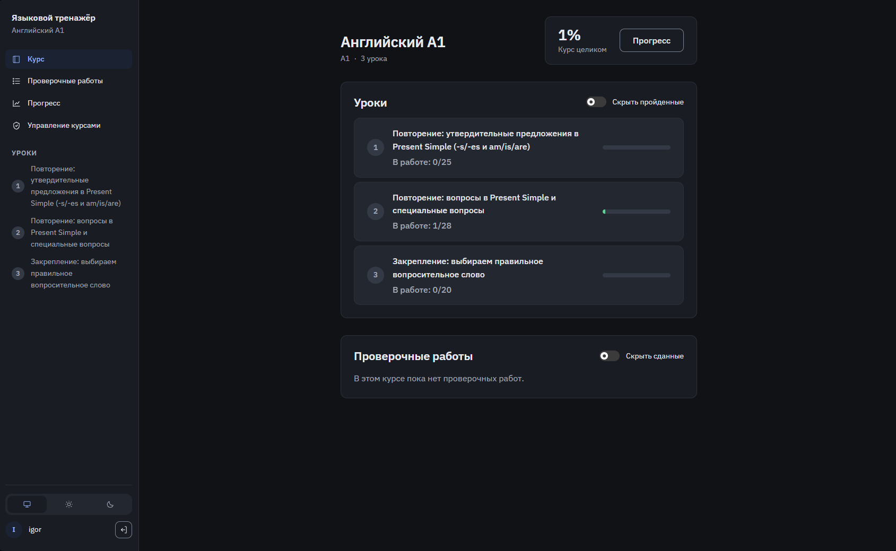
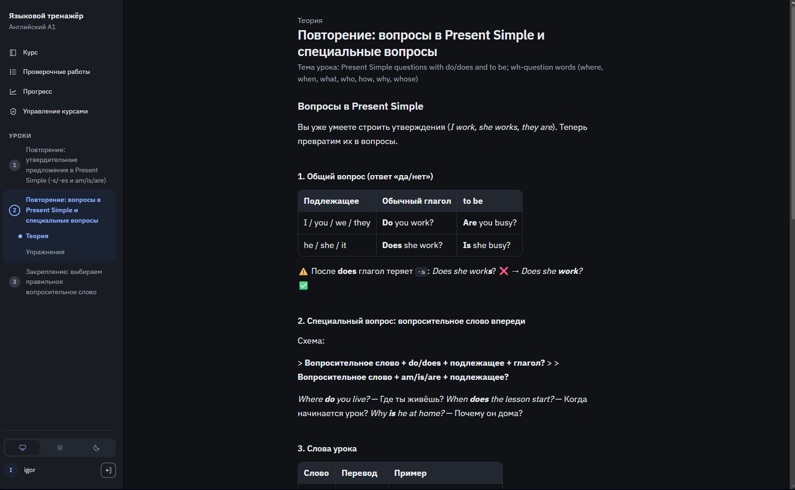
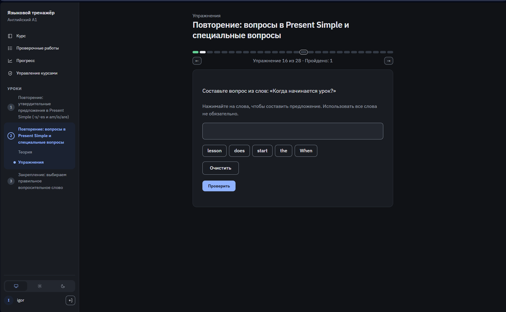
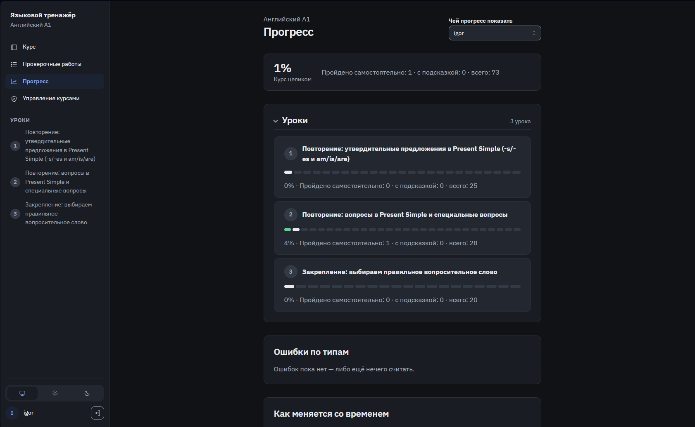

# Языковой тренажёр

Приватное веб-приложение для изучения английского и таджикского языков (интерфейс на русском). Курсы разбиты на уроки по уровням CEFR: каждый урок — теория в markdown и набор упражнений шести видов (составление фраз, перевод, свободное письмо, заполнение пропусков, выбор ответа, порядок слов). Есть проверочные работы с неограниченным числом попыток и страница прогресса со статистикой ошибок по типам.

Свободные ответы проверяет **Claude** через Claude Agent SDK: вместо «верно/неверно» студент получает разбор ошибок с их классификацией. Закрытые виды упражнений проверяются детерминированно. Администратор может генерировать и дорабатывать уроки с помощью Claude, каждая правка сохраняется как версия, которую можно восстановить.

## Скриншоты

| Курс | Теория |
|---|---|
|  |  |
| **Упражнение «порядок слов»** | **Прогресс студента** |
|  |  |

## Стек

- **Next.js 16** (App Router), **React 19**, **TypeScript**, **Mantine 9**
- **SQLite** (better-sqlite3) + **Drizzle ORM** с миграциями
- **Claude Agent SDK** — проверка ответов и генерация уроков
- Сессионная аутентификация, пароли хешируются **Argon2**
- Тесты на встроенном раннере Node (`node --test`)

## Хостинг

Приложение работает на домашнем **Raspberry Pi 5** (Linux), без облачных сервисов:

- **systemd** запускает `next start` на `127.0.0.1:4100` и перезапускает процесс при падении; отдельный `.path`-юнит автоматически перезапускает сервис после каждой новой сборки.
- **Caddy** — reverse proxy и единственная точка входа снаружи, автоматически выпускает TLS-сертификат.
- **DuckDNS** — динамический DNS: таймер раз в 5 минут обновляет запись при смене домашнего IP.
- **fail2ban** читает JSON-логи Caddy и блокирует перебор паролей.
- **Таймеры systemd**: ночной бэкап базы и загруженных изображений с ротацией и периодическая проверка доступности Claude, результат которой видно в админке.

Конфигурация развёртывания и порядок установки — в [`deploy/`](deploy/README.md).

## Локальный запуск

```bash
npm ci
cp .env.example .env        # поправить пути под свою машину
npm run db:migrate
SEED_ADMIN_PASSWORD=… SEED_STUDENT_PASSWORD=… npm run db:seed
npm run dev                 # http://localhost:4100
```

Нужен Node.js 24+ и авторизованный Claude Code (`~/.claude`) для проверки свободных ответов.
